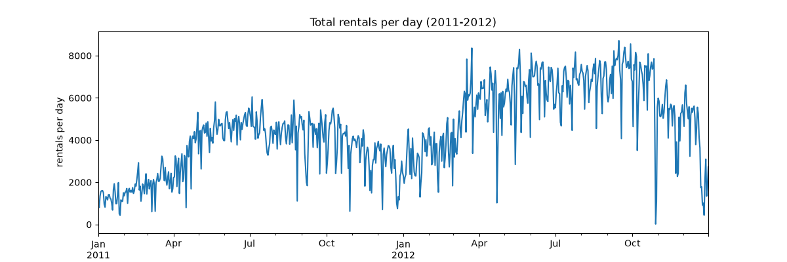
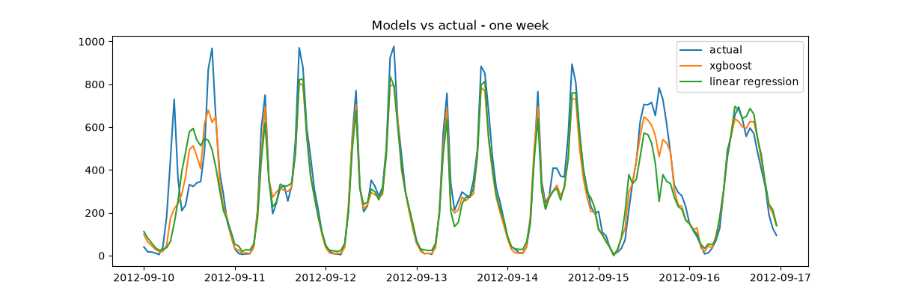
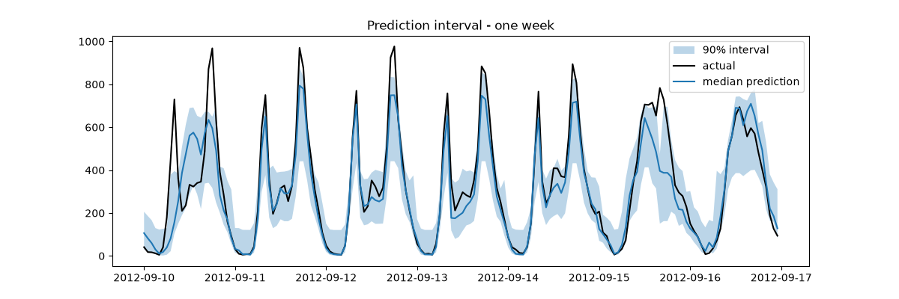
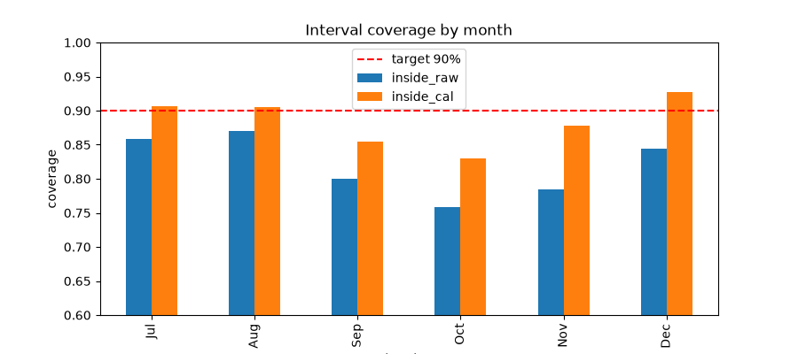
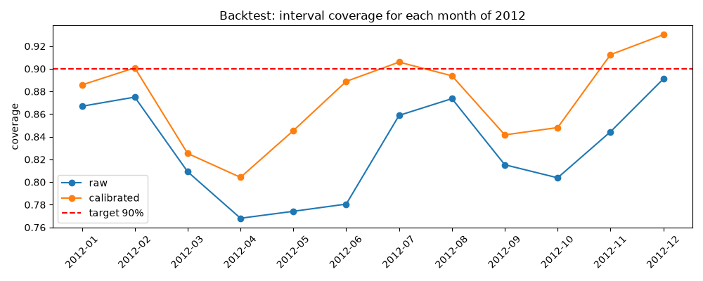
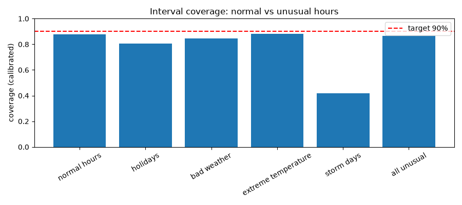
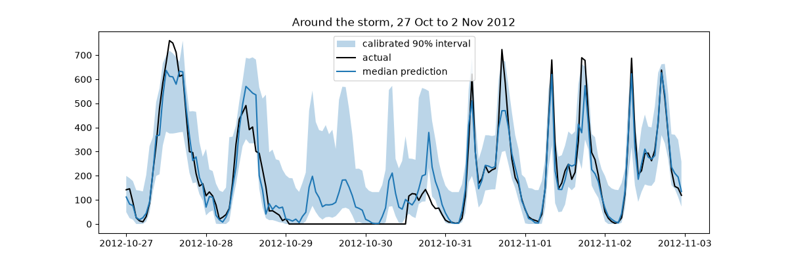

# Uncertainty-Aware Forecasting System

A project where I predict **how many bikes will be rented every hour**, and also say **how sure the model is** about each prediction.

I did this project to learn one thing: a model can have a good average accuracy and still give confidence intervals that you cannot trust. I wanted to see this with my own eyes on real data.

## The data

I used the **UCI Bike Sharing dataset** (Capital Bikeshare, Washington D.C.). It has hourly rentals for 2011 and 2012 (17,379 rows), plus weather and holiday info.

- I predict `cnt` (total rentals per hour)
- Train data: Jan 2011 to Jun 2012
- Test data: Jul 2012 to Dec 2012
- I always split by **time**, never randomly, because in real life you can't see the future



## What I did (step by step)

1. **Cleaned the data.** 165 hours were missing from the timeline. I assumed those hours had zero rentals (this is my assumption, not 100% sure).
2. **Baselines.** Same hour yesterday, same hour last week, and an average profile by hour.
3. **Features.** Hour (as sin/cos), weekday, month, weather, holiday, rentals 24 hours and 168 hours ago, and rolling averages.
4. **ML models.** Linear Regression and XGBoost.
5. **Quantile regression.** XGBoost models for the 5%, 50%, and 95% quantiles, which gives a 90% prediction interval.
6. **Calibration.** Used conformal prediction (conformalized quantile regression) with a separate calibration period to fix the intervals.
7. **Backtesting.** Ran the full pipeline for each month of 2012.
8. **Unusual periods.** Checked holidays, bad weather, extreme temperature, and the storm days.

## Results

### 1. Point forecasts (test: Jul to Dec 2012)

| Model | MAE | RMSE |
|---|---|---|
| Same hour yesterday | 80.4 | 134.5 |
| Same hour last week | 66.0 | 114.9 |
| Average profile | 107.8 | 151.1 |
| Linear regression | 59.6 | 92.3 |
| **XGBoost** | **47.4** | **73.8** |

XGBoost beat the best baseline by about 28% in MAE and 36% in RMSE.



### 2. Prediction intervals (target: 90% coverage)

My first quantile model said "90% interval" but the real values were inside only **85.7%** of the time. So the model was overconfident.



### 3. After calibration

| | Coverage | Average width |
|---|---|---|
| Raw quantile | 81.9% | 224 |
| Calibrated | 88.3% | 273 |

Calibration moved the coverage closer to 90%, but the intervals became about 22% wider. More honest intervals are wider, so there is a trade-off.

(Raw coverage here is lower than 85.7% because this version has less training data: I had to keep Apr to Jun 2012 for calibration.)



### 4. Backtest: the 12 months of 2012

For each month: test = that month, calibration = the 3 months before it, training = everything before that.

- Calibrated coverage was better than raw coverage in **every month**
- Average coverage over the 12 months: raw **83.0%**, calibrated **87.4%** (target 90%)
- The intervals also got about 17% wider on average (205 to 241)
- The worst month was April: 80.4% even after calibration
- March, April, May, September, and October all stayed below 85%
- Spring was the hardest because demand grows fast from March to June, and the model learns from the past so it underestimates



So the average looks okay, but the reliability changes a lot from month to month. This is the main thing I learnt.

### 5. Unusual periods (backtest over 2012, calibrated intervals)

| Group | Hours | MAE | Coverage | Avg width |
|---|---|---|---|---|
| Normal hours | 6895 | 51.7 | 87.6% | 235 |
| Holidays | 264 | 78.6 | 80.7% | 258 |
| Bad weather | 678 | 65.9 | 84.7% | 259 |
| Extreme temperature | 1053 | 52.7 | 88.3% | 267 |
| Storm days (29 to 30 Oct 2012) | 48 | 81.4 | **41.7%** | 291 |
| All unusual | 1889 | 60.2 | 86.4% | 265 |

- On 29 Oct 2012 there were only **22 rentals in the whole day**. This is the day Hurricane Sandy hit the US East Coast. Coverage that day was 25% and the next day 58%.
- The intervals did become wider in unusual periods, but not wide enough
- Holidays were also worse than normal days




## Problems I faced / things I learnt

- **Data leakage.** `casual + registered = cnt`, so using them as features would be cheating. I removed them.
- **Missing hours.** The dataset had 165 missing hours, which would break the "yesterday" and "last week" features, so I filled the timeline first.
- **Random split is wrong for time series.** The test data must come after the training data.
- **Quantile lines crossing.** Sometimes the lower line went above the median line, so I fixed it with min/max.
- **Good accuracy does not mean good intervals.** XGBoost looked great on MAE and RMSE, but the intervals under-covered.
- **Calibration is not magic.** Conformal prediction assumes the future looks like the calibration period. My data has a trend and sudden events, so it only partly worked.
- **Small groups are noisy.** The storm group has only 48 hours, so I should not trust its exact number too much.

## Limitations

- Only 2 years of data from one city
- The model only knows the past, so it cannot predict a hurricane
- I filled missing hours with zero, which is an assumption
- The calibration period was fixed to the 3 months before each test month. Other choices might work better

## What I want to try next

- Update the calibration over time (adaptive conformal prediction)
- Weather forecast features so the model can see bad weather coming
- A neural network (PyTorch) with quantile loss
- Try the same thing on another dataset (for example electricity demand)

## Project structure

```
data/         dataset (downloaded by a script)
notebooks/    01 explore, 02 baselines, 03 models, 04 quantile,
              05 calibration, 06 backtest, 07 unusual periods
src/          features.py, metrics.py, calibration.py, backtest.py, download_data.py
results/      charts and result tables
```

## How to run

```
python -m venv venv
venv\Scripts\activate
pip install -r requirements.txt
python src/download_data.py
```

Then run the notebooks in order from 01 to 07.

## Tech

Python, pandas, NumPy, scikit-learn, XGBoost, Matplotlib, Jupyter

## Data source

UCI Machine Learning Repository: Bike Sharing Dataset (Fanaee-T and Gama, 2013), CC BY 4.0.